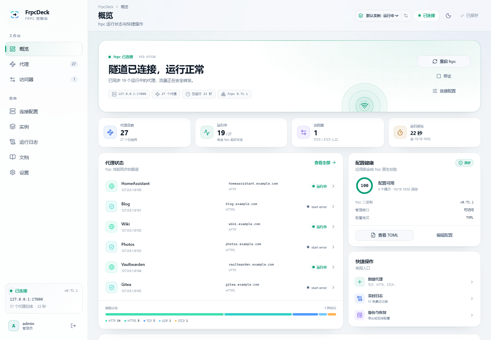
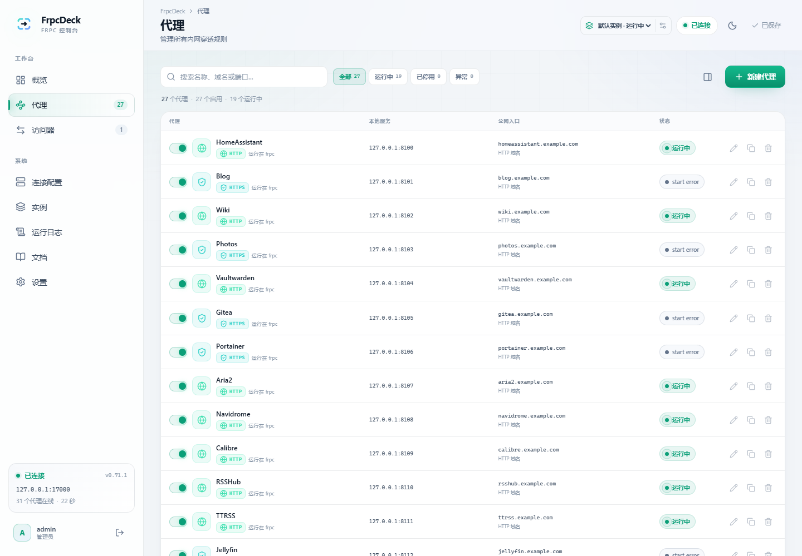
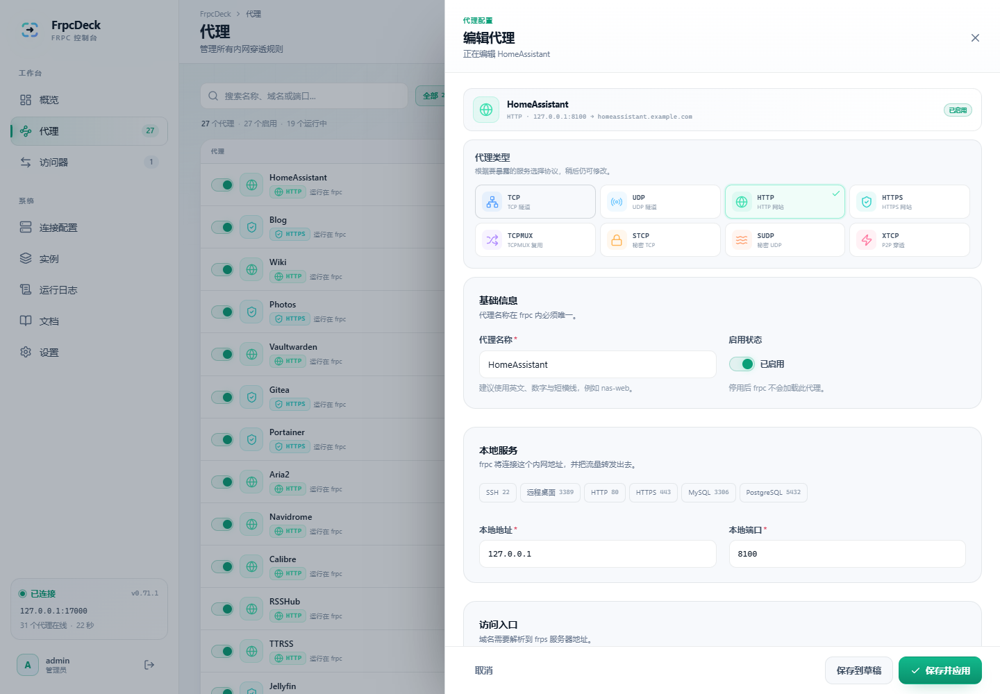
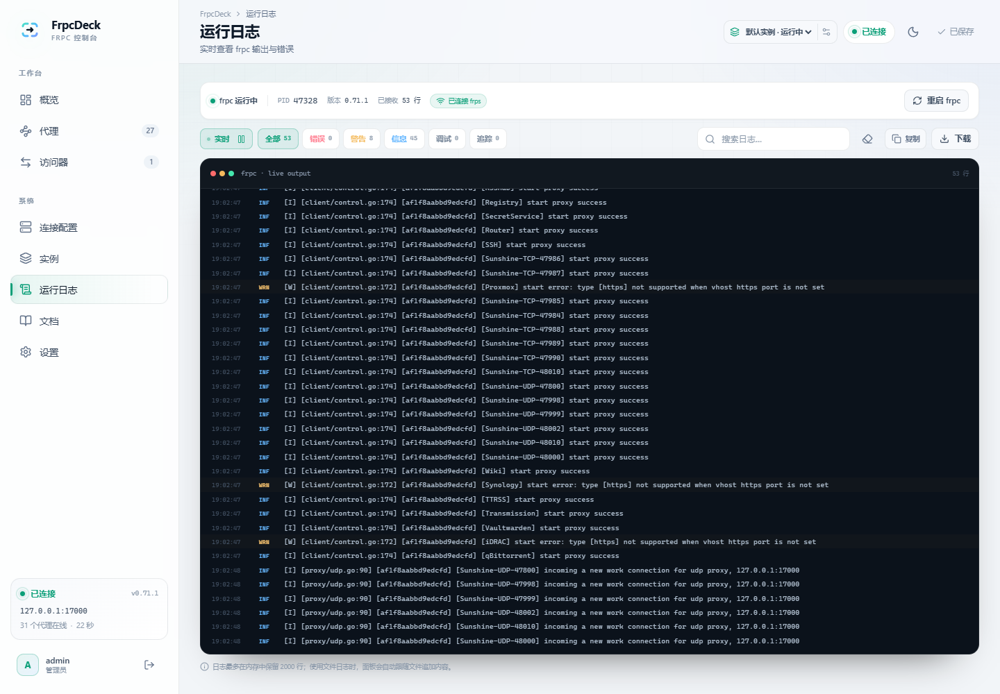
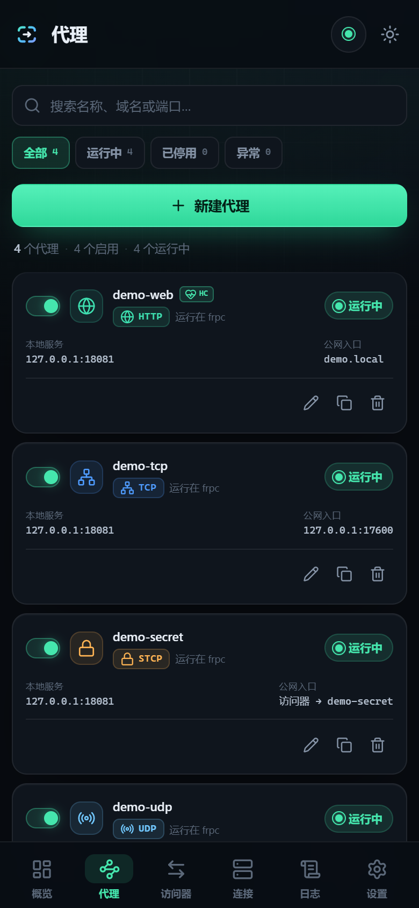

<p align="center">
  
</p>

<h1 align="center">FrpcDeck</h1>

<p align="center">
  A modern web UI for configuring, validating and running <a href="https://github.com/fatedier/frp">frpc</a><br/>
  Full configuration · live status · streaming logs · mobile ready · ships with frpc
</p>

<p align="center">
  <a href="README.md">简体中文</a> ·
  <a href="README.en.md">English</a>
</p>

<p align="center">
  <a href="https://github.com/Luqijian/FrpcDeck/actions/workflows/ci.yml"></a>
  <a href="https://github.com/Luqijian/FrpcDeck/tags"></a>
  <a href="https://github.com/Luqijian/FrpcDeck/pkgs/container/frpcdeck"></a>
  <a href="LICENSE"></a>
  
</p>



## What is FrpcDeck?

FrpcDeck is not an frps dashboard. It manages the **frpc client** running on your internal network: edit configuration through forms, validate it with frpc itself, start/restart the process, and inspect per-proxy status and logs.

One container includes the web UI, a Node service and frpc. No host Node.js installation and no hand-edited `frpc.toml` required.

## Features

- **Complete client configuration**: server connection, token / OIDC, transport, TLS, QUIC, logging, admin API, metadata, every proxy type and 10 plugins.
- **Native validation**: runs `frpc verify` before writing or applying a configuration.
- **Live runtime**: proxy status, connection state, PID, frpc version, uptime and assigned remote ports from frpc's admin API.
- **Streaming logs**: SSE log stream, level filters, search, pause, copy, download, file-log tailing.
- **Mobile first**: bottom navigation, bottom-sheet editors and a floating apply bar; all screens work at 320 px wide.
- **Security**: scrypt password hashing, signed HttpOnly cookies, login rate limiting, CSRF checks, CSP and 0600 sensitive files.
- **Backups & migration**: automatic backups before each apply, plus TOML / YAML / JSON / legacy INI import with unknown fields preserved.
- **Simple deployment**: multi-stage Docker image with frpc bundled; amd64, arm64 and arm.

| Proxies | Editor |
| --- | --- |
|  |  |

| Live logs | Mobile |
| --- | --- |
|  |  |

## Quick start

Public image: **`ghcr.io/luqijian/frpcdeck:latest`** (linux/amd64, linux/arm64)

Requirements: Docker 24+ and Docker Compose v2. No Node, pnpm or frp build environment is required when using the prebuilt image.

```bash
# optional: pull the image first
docker pull ghcr.io/luqijian/frpcdeck:latest

git clone https://github.com/Luqijian/FrpcDeck.git
cd FrpcDeck

cp .env.example .env
# Edit .env and set a strong FRPC_WEBUI_PASSWORD

docker compose pull
docker compose up -d
```

Open `http://<server-ip>:8080` and sign in with the credentials from `.env`.

> On Linux, if frpc must reach services on the host's `127.0.0.1`, use host networking:
>
> ```bash
> docker compose -f compose.host.yaml pull
> docker compose -f compose.host.yaml up -d
> ```

Build from source (for development or a custom frp version):

```bash
docker compose up -d --build
```

Pin a release with `IMAGE_TAG=1.0.0`. See the [deployment guide](docs/deployment.md) for image tags and hardening.

Then:

1. Open **Connection** and enter the frps address, port, token or OIDC settings.
2. Add a proxy (TCP / HTTP / STCP / ...).
3. Click **Apply changes**. FrpcDeck validates the configuration, writes `frpc.toml` and starts frpc.

To migrate an existing setup, import `frpc.toml` from **Connection → Import**, or place it in `./data/frpc.toml` before the first start. FrpcDeck will import it and create a backup automatically.

## Documentation

The detailed documentation is currently written in Chinese; English translations are welcome.

| Document | Content |
| --- | --- |
| [Deployment](docs/deployment.md) | Public GHCR image, Compose, host networking, environment variables, reverse proxy, upgrades |
| [Configuration](docs/configuration.md) | Supported fields, proxy types, plugins, visitors, import rules |
| [Architecture](docs/architecture.md) | Backend/frontend modules, data flow, process lifecycle, security model |
| [HTTP API](docs/api.md) | REST endpoints, SSE, authentication, error schema |
| [Development](docs/development.md) | Local setup, tests, adding fields, release checklist |
| [Troubleshooting](docs/troubleshooting.md) | Docker, frpc, login, logs and networking issues |

Index: [docs/README.md](docs/README.md).

## Compatibility

- Bundles **frpc 0.71.1** by default and targets the frp 0.71.x configuration surface.
- Keep frpc and frps versions aligned. Use the `FRP_VERSION` build argument to bundle a different version.
- The upstream `frpc_full_example.toml` is part of the round-trip test suite and the generated output passes `frpc verify`.
- Fields not exposed in the forms can still be imported and preserved as raw TOML.

## Security

FrpcDeck has full control over frpc. Treat it like SSH access:

- Use a strong password and restrict access to port 8080.
- Use an HTTPS reverse proxy for any non-LAN exposure, with `COOKIE_SECURE=true` and `TRUST_PROXY=true`.
- Never commit or share the `data/` directory; it contains tokens, secret keys and password hashes.
- The frpc admin API listens on `127.0.0.1` by default. Keep it that way.

To report a vulnerability, read [SECURITY.md](SECURITY.md).

## Development

```bash
pnpm install
pnpm dev      # UI on 5173, API on 8080
pnpm test     # config, store and API integration tests
pnpm build
```

Browser smoke test:

```bash
E2E_BASE_URL=http://127.0.0.1:8080 E2E_PASSWORD=your-password pnpm test:e2e
```

See [docs/development.md](docs/development.md) for details.

## Contributing

Issues and pull requests are welcome. Please read:

- [CONTRIBUTING.md](CONTRIBUTING.md)
- [CODE_OF_CONDUCT.md](CODE_OF_CONDUCT.md)
- [SECURITY.md](SECURITY.md)

If FrpcDeck is useful to you, a Star ⭐ helps others find it.

## License

[MIT](LICENSE) © 2026 Luqijian

frp and the upstream test fixture are distributed under their own licenses; see [THIRD_PARTY_NOTICES.md](THIRD_PARTY_NOTICES.md).
