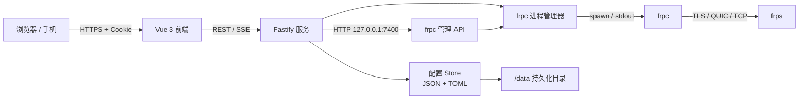

# 架构设计

## 总览

FrpcDeck 由一个 Node 服务和一个 Vue 单页应用组成，两者打包进同一个镜像，并随镜像携带 frpc。



- 前端只通过同源 REST 和 SSE 与后端通信。
- 后端用文件保存配置，不依赖数据库。
- frpc 是后端拉起的子进程；后端负责启停、日志、退出与自动重启。
- 实时代理状态来自 frpc 自带的管理接口（`webServer`），面板仅监听本机回环地址。

## 后端模块

| 文件 | 职责 |
| --- | --- |
| `server/index.js` | 环境变量、Fastify 启动、静态资源、安全头、优雅退出 |
| `server/routes.js` | 认证、实例、配置、运行控制、SSE、日志、设置、备份等 HTTP API |
| `server/instances.js` | 多实例管理器、实例目录迁移、独立 Store / FrpcManager / FrpsMonitor、自动启动 |
| `server/monitor.js` | 可选 frps Dashboard 流量采样、速率计算、历史快照 |
| `server/frpc.js` | frpc 子进程生命周期、stdout/stderr 捕获、日志跟随、状态轮询、自动重启 |
| `server/config.js` | 默认值、规范化、字段校验、TOML 生成、TOML/YAML/JSON/INI 导入 |
| `server/toml.js` | 无第三方依赖的 TOML 序列化器 |
| `server/store.js` | 数据目录、原子写入、备份、恢复、损坏配置隔离 |
| `server/auth.js` | scrypt 密码、首次启动随机密码、强制改密、签名会话、密码版本 |
| `shared/constants.js` | 前后端共享的代理/插件/枚举常量 |

## 前端模块

| 位置 | 职责 |
| --- | --- |
| `web/src/pages/` | 概览、代理、访问器、连接配置、实例、日志、设置 |
| `web/src/components/` | 表单、抽屉、标签输入、KV 编辑器、类型选择器、Toast 等 |
| `web/src/store.js` | 全局状态、实例切换、API 调用、SSE 连接、运行时轮询、主题 |
| `web/src/frp.js` | 类型元数据、默认代理/访问器、展示辅助函数 |
| `web/src/styles/` | 设计变量、组件、页面和响应式样式 |

前端使用 Vue 3 的 Composition API，不引入 UI 组件库，以保持视觉一致性和较小的 JS 体积。所有表单字段有可访问的 label，移动端使用抽屉式编辑器。

## 配置数据流

1. 浏览器加载 `GET /api/bootstrap`，通过 `X-FrpcDeck-Instance` 指定当前实例，得到该实例的配置、设置、frpc 版本和运行状态，以及实例列表。
2. 用户在结构化表单中修改草稿；只有点击「应用更改」才提交完整配置。

## 多实例模型

- 每个实例拥有独立的 `Store` 和 `FrpcManager`，配置、TOML、日志、备份、运行状态相互隔离。
- `InstanceManager` 在 `data/instances/<id>/` 下维护实例目录；`instances.json` 保存实例列表和默认实例。
- 请求通过 `X-FrpcDeck-Instance` 请求头选择实例；SSE 用 `?instance=`。`server/routes.js` 用 `AsyncLocalStorage` 将请求绑定到实例上下文。
- 每个实例分配不同的 `webServer.port`（默认 7400 起）和独立的随机管理密码。
- 首次升级时，旧的单实例文件自动迁移到 `instances/default/`；全局 `auth.json` 和 `session.key` 保留在数据根目录。
3. 后端做两步校验：
   - 字段级校验（必填、端口、重名、域名、插件字段等）；
   - 写临时 TOML，执行 `frpc verify`。
4. 校验通过后：
   - 备份当前配置到 `data/backups/`；
   - 原子写入 `data/config.json`；
   - 原子写入 `data/frpc.toml`（0600）；
   - 启动 / 重启 frpc。
5. 运行状态：
   - 面板每 4 秒请求 `http://127.0.0.1:<webServer.port>/api/status`；
   - 读取所有代理的状态；
   - 仅当状态变化时通过 SSE 推送。
6. 日志：
   - 子进程 stdout/stderr 按行捕获；
   - `log.to` 为文件时，轮询文件追加内容；
   - 环形缓冲最多 2000 行；
   - SSE 推送给浏览器，并过滤面板自身管理 API 的访问日志。

## 数据目录

```text
/data/
├─ auth.json                 # 全局：scrypt 盐、哈希、版本、来源
├─ session.key               # 全局：32 字节 HMAC 密钥
├─ instances.json            # 实例列表与默认实例
└─ instances/
   ├─ default/
   │  ├─ config.json         # 面板内部配置模型（含未知字段与批量代理）
   │  ├─ frpc.toml           # 生成的运行配置，0600
   │  ├─ settings.json       # autoStart / autoRestart
   │  └─ backups/            # 最近 30 份 JSON 备份
   └─ inst-xxxx/
      └─ ...
```

- 目录权限为 0700，敏感文件为 0600。
- 所有写入使用临时文件 + rename，避免半写入配置被 frpc 读取。
- 如果 `config.json` 损坏，会重命名为 `config.json.corrupt-*`，然后尝试从 `frpc.toml` 恢复。
- 首次启动且没有 `config.json` 时，会自动导入挂载进来的 `frpc.toml`。

## frpc 进程状态

```text
stopped ──start──▶ starting ──spawn──▶ running
   ▲                    │                 │
   │                    └──error──▶ error  │
   └──────── stop ◀── stopping ◀──────────┘
```

- `connection` 状态由日志关键字推断（`login to server success`、`connect to server error` 等）。
- 如果 frpc 异常退出且开启自动重启，按指数退避（最长 30 秒）重试。
- 停止时先 SIGTERM，5 秒未退出则 SIGKILL。
- 面板会检测 `start proxy success` 并主动刷新状态。

## 批量端口模型

批量端口不是独立模式，而是代理模型上的可选字段：

```json
{
  "name": "Sunshine-TCP",
  "type": "tcp",
  "batch": {
    "localPorts": "47984-47990,48010",
    "remotePorts": "47984-47990,48010",
    "namePattern": "Sunshine-TCP-{localPort}"
  }
}
```

- `parseConfigText` 先尝试普通 TOML；失败且存在 `parseNumberRangePair` 时，提取每个 range 块，按采样端口解析出普通代理字段，再写入 `batch`；
- `shared/ports.js` 负责端口范围展开、配对校验和名称模板求值，前后端共用；
- `generateToml` 对普通代理输出 `[[proxies]]`，对批量代理输出一个 `{{- range ... }}` 块；
- 每条批量代理仍是一个 UI 条目；运行时按名称模板生成名称，前端用生成名称集合聚合运行状态；
- 管理接口仍是普通 `webServer` 字段，不依赖模板注入。

## 安全模型

- **认证**：管理员密码用 scrypt（N=16384）加盐哈希；会话是 HMAC-SHA256 签名的 HttpOnly Cookie，7 天有效。
- **首次启动**：生成随机初始密码并打印到容器日志，记录 `mustChangePassword`；中间件只允许改密接口，直到用户修改用户名和密码。
- **凭据管理**：用户名和密码在「设置 → 管理员账户」中修改；修改会提升密码版本并使旧会话失效。
- **CSRF**：所有修改请求要求 `X-FrpcDeck: 1`，并检查 Origin/Host；前端 API 客户端统一附加该头。
- **限流**：登录失败按 IP 限制（10 分钟窗口，8 次后封禁 10 分钟）。
- **CSP / 安全头**：CSP、X-Frame-Options、nosniff、Referrer-Policy、Permissions-Policy；HTTPS 下额外发送 COOP。
- **命令执行**：frpc 子进程通过参数数组启动，不经过 shell；配置内容只写入文件。
- **管理接口**：每个实例的 frpc webServer 只监听 `127.0.0.1`，端口从 7400 起自动分配；密码通过 `FRPCDECK_ADMIN_PASSWORD` 环境模板注入，不写入 `frpc.toml`。
- **最小暴露面**：面板只提供同源 API，不启用 CORS；静态资源没有用户上传路径。

## 测试分层

- `tests/config.test.js`：TOML 生成、官方完整示例往返、批量端口解析/校验/导出。
- `tests/store.test.js`：首次导入、批量端口首次导入、损坏恢复、备份、原子写入。
- `tests/instances.test.js`：旧单实例数据迁移、多实例创建/切换/重命名/删除、管理端口隔离。
- `tests/api.test.js`：启动真实服务进程，覆盖认证、CSRF、配置、批量端口导入、实例 API、备份、SSE、改密、重置。
- `tests/e2e.mjs`：浏览器冒烟测试（Playwright + 系统 Chrome）。
- 手工验证：真实 frps/frpc 下两个实例并行运行、TCP/HTTP/STCP/UDP、访问器、文件日志跟随。

## 设计取舍

- **文件存储而非数据库**：配置小、备份/迁移简单；多实例使用独立目录，不需要额外服务。
- **两阶段校验**：结构化校验给用户友好提示，frpc 原生校验兜底真实兼容性。
- **面板保留管理接口**：为实时状态提供稳定入口，牺牲“完全关闭”这个自由度。
- **导入保留未知字段**：便于跟随 frp 新版本，不强迫用户等待 UI 更新。
- **批量端口可视化**：把端口范围作为代理字段而不是原始模板保存，保证导入、新建、编辑和导出使用同一套模型；导出时再生成 frp 的 `parseNumberRangePair` 块。
- **重启而非热加载**：实现简单、行为可预测；配置变更频率低，重启耗时通常小于 1 秒。
