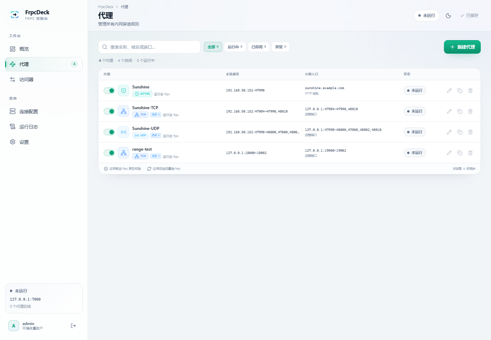
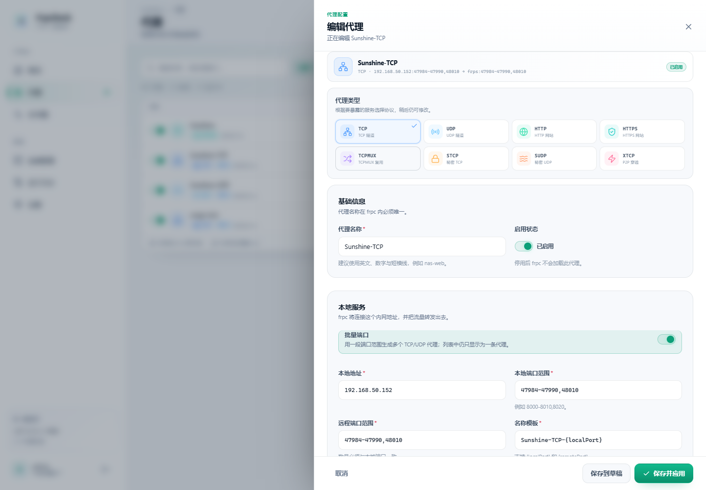

# 配置说明

FrpcDeck 用结构化表单管理 frpc 配置，并在保存时生成标准 TOML 交给 frpc 自己校验。本文档说明面板覆盖的字段、特殊行为与导入规则。

参考版本：**frp 0.71.x**。官方字段列表见 [frpc_full_example.toml](https://github.com/fatedier/frp/blob/dev/conf/frpc_full_example.toml)。

## 配置流程

1. 在「连接配置」填写 frps 连接信息；
2. 在「代理」中添加代理；
3. 需要访问其他 frpc 的 STCP/XTCP 服务时，在「访问器」中添加访问器；
4. 点击右上角「应用更改」。

保存时依次执行：

- 面板字段校验（必填、端口范围、重名等）；
- 生成 TOML；
- `frpc verify -c <临时文件>` 原生校验；
- 写入 `data/frpc.toml`（0600）；
- 备份旧配置；
- 启动或重启 frpc。

任何一步失败都会在面板顶部展示结构化错误，不会把未通过校验的配置写入运行文件。

## 客户端字段

### 服务端与身份

- `serverAddr`、`serverPort`
- `user`、`clientID`
- `loginFailExit`
- `natHoleStunServer`
- `dnsServer`
- `udpPacketSize`

### 认证

- `auth.method`：`token` / `oidc`
- `auth.token`
- `auth.tokenSource.type = "file"` 与 `auth.tokenSource.file.path`
- `auth.additionalScopes`：`HeartBeats` / `NewWorkConns`
- OIDC：
  - `clientID`、`clientSecret`、`audience`、`scope`
  - `tokenEndpointURL`
  - `additionalEndpointParams`
  - `trustedCaFile`、`insecureSkipVerify`、`proxyURL`

### 传输与 TLS

- `transport.protocol`：`tcp` / `kcp` / `quic` / `websocket` / `wss`
- `transport.wireProtocol`：`v1` / `v2`
- `transport.poolCount`
- `transport.tcpMux`、`transport.tcpMuxKeepaliveInterval`
- `transport.dialServerTimeout`、`transport.dialServerKeepalive`
- `transport.connectServerLocalIP`
- `transport.proxyURL`
- `transport.heartbeatInterval`、`transport.heartbeatTimeout`
- `transport.quic`：keepalivePeriod / maxIdleTimeout / maxIncomingStreams
- `transport.tls`：enable / certFile / keyFile / trustedCaFile / serverName / disableCustomTLSFirstByte

### 日志与管理接口

- `log.to`（`console` 或文件路径）
- `log.level`、`log.maxDays`、`log.disablePrintColor`
- `webServer.addr`、`port`、`user`、`password`、`assetsDir`、`pprofEnable`

### 高级

- `start`：启动白名单
- `includes`：包含其他配置文件
- `metadatas`
- `featureGates.VirtualNet`
- `virtualNet.address`

## 代理类型

| 类型 | 用途 | 关键字段 |
| --- | --- | --- |
| `tcp` | 任意 TCP 服务 | localIP / localPort / remotePort |
| `udp` | UDP 服务 | localIP / localPort / remotePort |
| `http` | 基于域名的 HTTP | customDomains / subdomain / locations / httpUser 等 |
| `https` | 基于域名的 HTTPS | customDomains / subdomain / proxyProtocolVersion 等 |
| `tcpmux` | HTTP CONNECT 复用 | multiplexer=httpconnect / customDomains |
| `stcp` | 秘密 TCP，需要访问器 | secretKey / allowUsers |
| `sudp` | 秘密 UDP，需要访问器 | secretKey / allowUsers |
| `xtcp` | P2P NAT 穿透，需要访问器 | secretKey / allowUsers / natTraversal |

所有代理还可以配置：

- `enabled`：是否启用；
- `transport.bandwidthLimit` / `bandwidthLimitMode`；
- `transport.useEncryption` / `useCompression` / `proxyProtocolVersion`；
- `loadBalancer.group` / `groupKey`；
- `healthCheck`（TCP 或 HTTP、路径、请求头、间隔、超时、最大失败次数）；
- 请求头 / 响应头改写；
- `metadatas`、`annotations`；
- `natTraversal.disableAssistedAddrs`；
- 插件。

## 插件

| 插件 | 说明 | 主要字段 |
| --- | --- | --- |
| `unix_domain_socket` | 转发 Unix Socket | unixPath |
| `http_proxy` | 作为 HTTP 代理 | httpUser / httpPassword |
| `socks5` | 作为 SOCKS5 代理 | username / password |
| `static_file` | 静态文件服务 | localPath / stripPrefix / httpUser / httpPassword |
| `https2http` | HTTPS → 本地 HTTP | localAddr / crtPath / keyPath / hostHeaderRewrite |
| `https2https` | HTTPS → 本地 HTTPS | localAddr / crtPath / keyPath / hostHeaderRewrite |
| `http2https` | HTTP → 本地 HTTPS | localAddr / hostHeaderRewrite |
| `http2http` | HTTP → 本地 HTTP | localAddr / hostHeaderRewrite |
| `tls2raw` | 解密 TLS 后转发原始 TCP | localAddr / crtPath / keyPath |
| `virtual_net` | 加入 frps 虚拟网络 | 无额外字段 |

插件中的证书、私钥和目录路径以 frpc 容器的 `/data` 工作目录为基准。请根据实际挂载位置填写绝对路径或相对 `/data` 的路径。

## 访问器

支持 `stcp`、`sudp`、`xtcp`：

- `serverName`：目标代理名；
- `serverUser`：目标用户（可选）；
- `secretKey`；
- `bindAddr` / `bindPort`（`-1` 表示只供 fallback 使用）；
- XTCP：`keepTunnelOpen`、`maxRetriesAnHour`、`minRetryInterval`、`fallbackTo`、`fallbackTimeoutMs`；
- `plugin.virtual_net.destinationIP`；
- `natTraversal.disableAssistedAddrs`。

## 示例：TCP

```toml
serverAddr = "frps.example.com"
serverPort = 7000

auth.method = "token"
auth.token = "change-me"

[[proxies]]
name = "ssh"
type = "tcp"
localIP = "127.0.0.1"
localPort = 22
remotePort = 6001
```

## 示例：HTTP + 健康检查

```toml
[[proxies]]
name = "web"
type = "http"
localIP = "127.0.0.1"
localPort = 8080
customDomains = ["app.example.com"]

[proxies.healthCheck]
type = "http"
path = "/health"
intervalSeconds = 10
maxFailed = 3
timeoutSeconds = 3
```

## 示例：STCP + 访问器

服务端 frpc 的代理：

```toml
[[proxies]]
name = "secret-ssh"
type = "stcp"
localIP = "127.0.0.1"
localPort = 22
secretKey = "a-long-random-secret"
allowUsers = ["*"]
```

客户端 frpc 的访问器：

```toml
[[visitors]]
name = "secret-ssh-visitor"
type = "stcp"
serverName = "secret-ssh"
secretKey = "a-long-random-secret"
bindAddr = "127.0.0.1"
bindPort = 9000
```

访问 `127.0.0.1:9000` 即可到达服务端 frpc 的 22 端口。

## 导入与导出

支持格式：

- TOML（推荐）
- TOML + `parseNumberRangePair` 批量端口
- YAML
- JSON
- 旧版 INI（会做字段映射，极少数旧字段可能被忽略）

导入时：

- 解析后先规范化字段；
- 未知字段会保留，并在重新生成 TOML 时原样输出；
- 如果导入内容没有 `webServer`，面板会保留当前的管理接口设置，避免自己的实时状态监控失效；
- 导入只会替换草稿，仍需要点击「应用更改」；
- 单文件上限 1 MB。

导出：

- 「设置 → 导入与导出」可以下载 `frpc.toml` 或面板 JSON；
- 「连接配置 → 查看 TOML」可预览当前配置。

## 批量端口

批量端口和普通代理使用同一个配置模型。导入下面这种 frp 端口范围写法时，FrpcDeck 会把它解析成一个**批量代理**，而不是展开成多条记录：

```toml
{{- range $_, $v := parseNumberRangePair "47984-47990,48010" "47984-47990,48010" }}
[[proxies]]
name = "Sunshine-TCP-{{ $v.First }}"
type = "tcp"
localIP = "192.168.50.152"
localPort = {{ $v.First }}
remotePort = {{ $v.Second }}
{{- end }}
```

规则：

- 每个 `parseNumberRangePair` 块对应**一个**可编辑的批量代理；
- 一对端口范围必须数量一致，范围支持 `8000-8010` 和逗号分隔的 `8000,8002,8010`；
- 名称模板支持 `{localPort}` 和 `{remotePort}`，例如 `Sunshine-TCP-{localPort}`；
- `type` 仅支持 `tcp` / `udp`；其他代理类型仍使用普通代理编辑器；
- `transport`、健康检查、限速等公共字段会应用到该批次生成的每个代理；
- 导出时重新生成 `range` + `parseNumberRangePair` 块，语义与导入一致，但不保证保留原始注释和空白；
- 应用前仍由 `frpc verify` 检查最终渲染后的配置。

「代理」列表中，一个批量代理只占一行，并显示批次数；运行状态按该批次生成的所有代理聚合：

- 全部运行：运行中
- 部分运行：等待中
- 任一条启动失败：异常
- frpc 未运行：未运行

导入、新建、编辑和导出都走同一套界面。新建 TCP/UDP 代理时打开「批量端口」即可填写范围；编辑已有批量代理时会回填范围与名称模板。





FrpcDeck 只识别 `parseNumberRangePair` 端口范围模式。包含 `if`、自定义函数或其他 Go template 逻辑的配置会被拒绝并提示，而不是进入单独的“模板模式”。

官方语法参考：[Port Range Mapping](https://gofrp.org/en/docs/features/common/range/)。

## 校验规则概览

面板会检查：

- frps 地址、端口；
- Token / OIDC 必填项；
- TCP/UDP 的远程端口；批量端口检查范围数量、端口合法性和生成名称唯一性；
- HTTP/HTTPS/TCPMUX 的域名；
- STCP/SUDP/XTCP 的 secretKey；
- 访问器绑定端口与目标代理名；
- 插件必填字段；
- 健康检查、限速、Proxy Protocol 等格式；
- 代理 / 访问器重名；
- `webServer` 端口冲突。

最终以 `frpc verify` 的结果为准。frpc 不可用时，面板会跳过原生校验并提示，但字段校验仍会执行。

## 已知边界

- **管理接口由面板保留**：为了保证实时状态，面板总是生成 `webServer` 配置，默认监听 127.0.0.1。
- **批量端口仅支持 TCP/UDP**：其他代理类型仍可正常新建和编辑，但不支持端口范围。
- **只识别端口范围模板**：`if`、自定义函数等任意 Go template 不支持，会给出明确错误。
- **includes 中的代理不显示**：通过 `includes` 加载的代理由 frpc 管理，面板无法读取其详情；建议迁移到面板。
- **start 白名单优先于 enabled**：如果设置了 `start`，未列入其中的代理不会启动。
- **未覆盖字段**：未来新增或极冷门字段可以通过「导入配置」直接写 TOML；结构化表单不会全部展开。
- **frpc 与 frps 版本**：建议保持一致。默认镜像为 0.71.1，可通过构建参数替换。

## 兼容性验证

项目自带官方 `frpc_full_example.toml` 的解析/生成往返测试，覆盖 18 个代理、3 个访问器、10 种插件；生成结果通过 `frpc verify`。`tests/fixtures/frpc_template.toml` 额外验证批量端口导入为 3 个可视化代理、导出后保留 2 个 `parseNumberRangePair` 块，并通过真实 frpc 校验。
