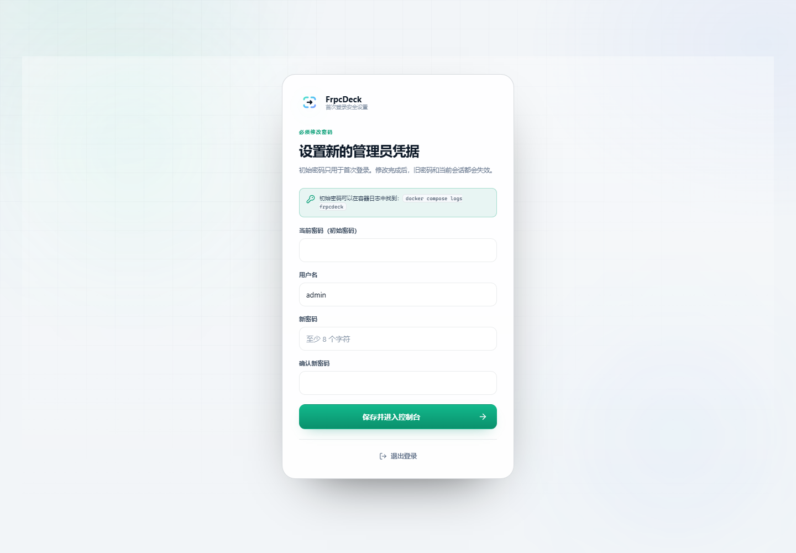
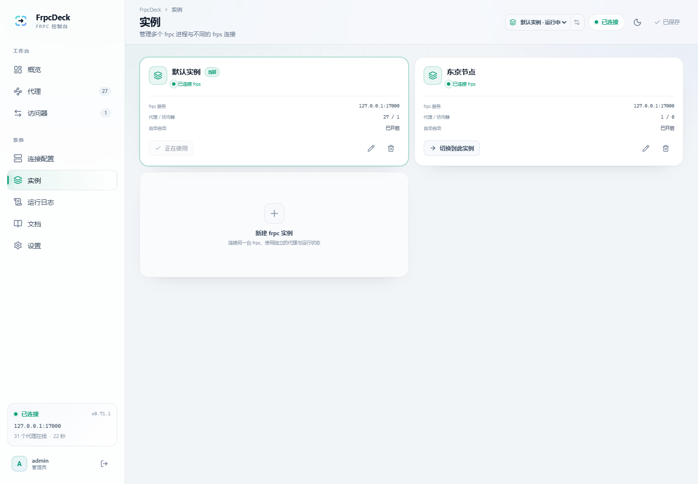
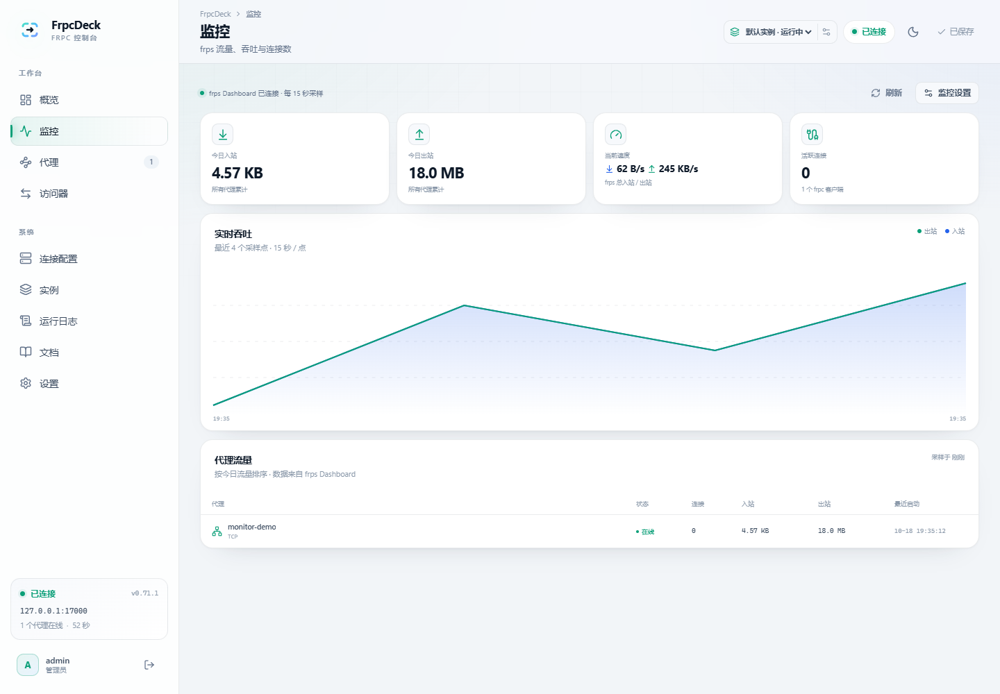
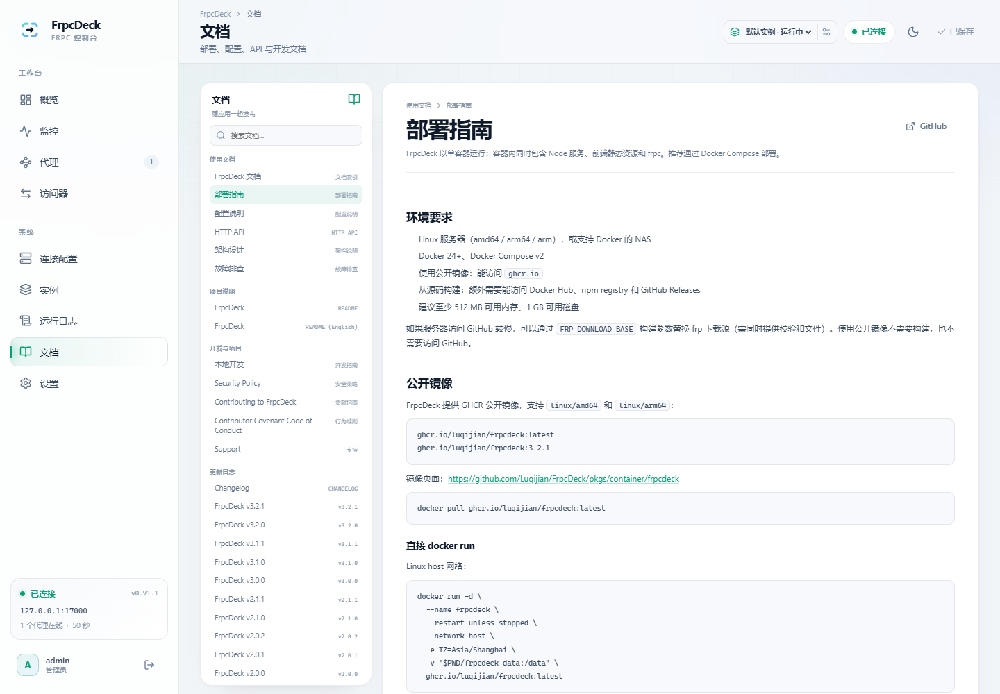

# 部署指南

FrpcDeck 以单容器运行：容器内同时包含 Node 服务、前端静态资源和 frpc。推荐通过 Docker Compose 部署。

## 环境要求

- Linux 服务器（amd64 / arm64 / arm），或支持 Docker 的 NAS
- Docker 24+、Docker Compose v2
- 使用公开镜像：能访问 `ghcr.io`
- 从源码构建：额外需要能访问 Docker Hub、npm registry 和 GitHub Releases
- 建议至少 512 MB 可用内存、1 GB 可用磁盘

如果服务器访问 GitHub 较慢，可以通过 `FRP_DOWNLOAD_BASE` 构建参数替换 frp 下载源（需同时提供校验和文件）。使用公开镜像不需要构建，也不需要访问 GitHub。

## 公开镜像

FrpcDeck 提供 GHCR 公开镜像，支持 `linux/amd64` 和 `linux/arm64`：

```text
ghcr.io/luqijian/frpcdeck:latest
ghcr.io/luqijian/frpcdeck:3.2.1
```

镜像页面：<https://github.com/Luqijian/FrpcDeck/pkgs/container/frpcdeck>

```bash
docker pull ghcr.io/luqijian/frpcdeck:latest
```

### 直接 docker run

Linux host 网络：

```bash
docker run -d \
  --name frpcdeck \
  --restart unless-stopped \
  --network host \
  -e TZ=Asia/Shanghai \
  -v "$PWD/frpcdeck-data:/data" \
  ghcr.io/luqijian/frpcdeck:latest
```

bridge 网络需要映射面板端口：

```bash
docker run -d \
  --name frpcdeck \
  --restart unless-stopped \
  -p 8080:8080 \
  --add-host host.docker.internal:host-gateway \
  -e TZ=Asia/Shanghai \
  -v "$PWD/frpcdeck-data:/data" \
  ghcr.io/luqijian/frpcdeck:latest
```

> 使用预构建镜像时，`IMAGE_TAG` 控制 Compose 拉取的标签；`latest` 跟随主分支，生产环境建议固定为 `3.2.1`。

## 快速开始（无需克隆仓库）

只需要创建两个文件，不需要下载源码。Linux / NAS 上执行：

```bash
mkdir -p ~/frpcdeck && cd ~/frpcdeck
```

创建 `compose.yaml`：

```yaml
name: frpcdeck

services:
  frpcdeck:
    image: ghcr.io/luqijian/frpcdeck:${IMAGE_TAG:-3.2.1}
    container_name: frpcdeck
    restart: unless-stopped
    stop_grace_period: 15s
    ports:
      - "${WEBUI_PORT:-8080}:8080"
    extra_hosts:
      - "host.docker.internal:host-gateway"
    environment:
      TZ: ${TZ:-Asia/Shanghai}
      PORT: "8080"
      DATA_DIR: /data
      COOKIE_SECURE: ${COOKIE_SECURE:-false}
      TRUST_PROXY: ${TRUST_PROXY:-false}
      ALLOWED_ORIGINS: ${ALLOWED_ORIGINS:-}
    volumes:
      - ./data:/data
```

创建 `.env`：

```dotenv
# 面板端口
WEBUI_PORT=8080

# 固定版本；latest 会跟随主分支
IMAGE_TAG=3.2.1

# 时区
TZ=Asia/Shanghai

# 通过 HTTPS 反向代理访问时设为 true
COOKIE_SECURE=false

# 位于反向代理之后时设为 true
TRUST_PROXY=false

# 反向代理改写 Host 时填写，例如 https://frp.example.com
ALLOWED_ORIGINS=
```

启动：

```bash
docker compose pull
docker compose up -d

# 首次启动随机密码只打印在日志中
docker compose logs frpcdeck | grep 初始密码
```

访问 `http://<服务器IP>:8080`，使用用户名 `admin` 和日志中的初始密码登录。首次登录会强制修改用户名和密码。

> Windows / macOS 用户不需要执行 `cat >`，直接用文本编辑器新建 `compose.yaml` 和 `.env`，粘贴上面的内容，然后在两个文件所在目录运行 `docker compose up -d`。
>
> 没有 `grep` 的环境可以运行 `docker compose logs frpcdeck`，在输出中查找「初始密码」。

首次启动后：

1. 打开「连接配置」，填写 frps 地址、端口和 token / OIDC；
2. 打开「代理」，添加 TCP、HTTP、STCP 等规则；
3. 点击右上角「应用更改」。FrpcDeck 会：
   - 用 `frpc verify` 校验生成配置；
   - 将配置写入数据目录的 `frpc.toml`；
   - 启动或重启自己的 frpc 进程。

从源码构建（仅开发或需要自定义 frp 版本时，需要克隆仓库）：

```bash
git clone https://github.com/Luqijian/FrpcDeck.git
cd FrpcDeck
docker compose up -d --build
```

## Linux 推荐：host 网络

默认的 bridge 网络只映射 8080 端口。此时容器里的 `127.0.0.1` 是容器自身，不是宿主机。

如果要代理宿主机上的服务，有两种方式：

1. 把代理的「本地地址」写成 `host.docker.internal`（上面的 compose 已配置 `host-gateway`）；
2. 使用 host 网络。把 `compose.yaml` 替换为：

```yaml
name: frpcdeck

services:
  frpcdeck:
    image: ghcr.io/luqijian/frpcdeck:${IMAGE_TAG:-3.2.1}
    container_name: frpcdeck
    restart: unless-stopped
    stop_grace_period: 15s
    network_mode: host
    environment:
      TZ: ${TZ:-Asia/Shanghai}
      HOST: 0.0.0.0
      PORT: ${WEBUI_PORT:-8080}
      DATA_DIR: /data
      COOKIE_SECURE: ${COOKIE_SECURE:-false}
      TRUST_PROXY: ${TRUST_PROXY:-false}
      ALLOWED_ORIGINS: ${ALLOWED_ORIGINS:-}
    volumes:
      - ./data:/data
```

`.env` 保持不变，重启：

```bash
docker compose up -d
```

host 网络下：

- frpc 可以直接访问宿主机的 `127.0.0.1`；
- 面板直接监听 `WEBUI_PORT`（默认 8080）；
- 不需要也不支持 `ports` 映射。

> Docker Desktop（Windows / macOS）对 host 网络支持有限，Linux 服务器和大多数 NAS 推荐使用 host 模式。

## 接入现有 frpc.toml

有两种方式：

**方式一：首次启动前放入数据目录**

```bash
mkdir -p data
cp /path/to/frpc.toml data/frpc.toml
docker compose pull
docker compose up -d
```

首次启动时，如果没有 `data/config.json`，FrpcDeck 会导入 `data/frpc.toml`，并创建一份备份到 `data/backups/`。

**方式二：登录后从面板导入**

「连接配置 → 导入配置」支持 TOML / YAML / JSON / 旧版 INI。导入会替换当前草稿，检查无误后再点击「应用更改」。

> 如果原 frpc 进程仍在运行，请先停止它，避免同名的远程端口或代理名冲突。面板启动的是独立的 frpc 进程，不会接管系统里已有的 frpc 服务。

## 环境变量

| 变量 | 默认值 | 说明 |
| --- | --- | --- |
| `IMAGE_TAG` | `latest` | Compose 使用的 GHCR 镜像标签，例如 `3.2.1`。 |
| `PORT` | `8080` | 面板监听端口（容器内）。 |
| `HOST` | `0.0.0.0` | 面板监听地址。 |
| `DATA_DIR` | `/data`（镜像内） | 配置、认证、备份、会话密钥的持久化目录。 |
| `FRPC_BIN` | `frpc` | frpc 可执行文件路径；镜像内为 `/usr/local/bin/frpc`。 |
| `COOKIE_SECURE` | `false` | 通过 HTTPS 访问时设为 `true`。 |
| `TRUST_PROXY` | `false` | 位于反向代理后时设为 `true`，以获取真实客户端 IP。 |
| `ALLOWED_ORIGINS` | 空 | 反向代理改写 Host 时允许的 Origin，逗号分隔。 |
| `TZ` | `Asia/Shanghai` | 容器时区。 |
| `LOG_LEVEL` | `info` | Node/Fastify 日志级别。 |

## 管理员账户

- **不需要配置密码环境变量**。首次启动时 FrpcDeck 生成随机初始密码并打印到容器日志。
- 查看初始密码：

```bash
docker compose logs frpcdeck | grep 初始密码
```

- 登录后会被强制修改用户名和密码；在「设置 → 管理员账户」中也可以再次修改。
- 密码只以 scrypt 哈希保存在 `data/auth.json`，不会写入 `frpc.toml`。
- 忘记密码时，停止容器，删除 `data/auth.json`，再启动容器；会生成新的随机密码并打印到日志。代理配置、备份和 frps 数据不会丢失。
- **升级已有部署不会重新生成初始密码**：已有账户用原密码登录后修改；如果日志中没有密码，用上面的删除 `auth.json` 方式重置。
- 容器日志可能被采集系统保存；首次登录修改密码后，建议清理或轮换日志中的初始密码。



## 构建参数

以下参数仅在使用 `docker compose up -d --build` 从源码构建时生效。

| 参数 | 默认值 | 说明 |
| --- | --- | --- |
| `FRP_VERSION` | `0.71.1` | 镜像内 frpc 版本。建议与 frps 版本保持一致。 |
| `FRP_DOWNLOAD_BASE` | GitHub Releases | frp 下载前缀，可替换为镜像站。 |
| `NODE_IMAGE` | `node:22-alpine` | 构建与运行基础镜像。 |

示例：

```bash
FRP_VERSION=0.71.1 IMAGE_TAG=local docker compose build --no-cache
IMAGE_TAG=local docker compose up -d
```

> 镜像标签由 `IMAGE_TAG` 控制；`FRP_VERSION` 只影响构建产物。固定使用公开镜像时，无需设置 `FRP_VERSION`。

## 多实例

一个 FrpcDeck 可以同时管理多个 frpc 实例，每个实例连接不同的 frps：



- 打开「实例」页面，点击「新建 frpc 实例」
- 填写实例名称、frps 地址/端口和可选 Token
- 创建后会自动切换到新实例；之后的「代理」「访问器」「连接配置」「运行日志」只作用于当前实例
- 顶部栏可以随时切换实例，切换后页面、SSE 状态和日志流都会切换到对应实例
- 每个实例有独立的代理、访问器、备份和自动启动设置
- 实例删除后配置会移到 `data/instances/.deleted/`，不会立即物理清除

每个 frpc 进程都会占用自己的本地管理端口，默认 7400、7401……；新建实例时会自动分配，避免冲突。

## frps 流量监控

监控页面需要读取 frps Dashboard。frpc 的本地管理接口不提供流量统计。

在 frps 配置中启用 Dashboard：

```toml
webServer.addr = "0.0.0.0"
webServer.port = 7500
webServer.user = "admin"
webServer.password = "change-me"
```

然后在每个实例的 **设置 → frps 流量监控** 中填写地址和认证信息。地址留空时会尝试 `http://<frps地址>:7500`。

- 每 15 秒采样一次，页面读取缓存，不对 frps 高频请求
- 未启用时零额外请求
- 建议只在内网开放 7500，或放在 HTTPS 反向代理后面



## 内置文档

登录后侧边栏的「文档」页面会直接展示随镜像发布的 Markdown 文档，支持分类导航、搜索、代码块、表格、截图和文档间跳转。



文档内容来自仓库的 `docs/`、README、CHANGELOG、SECURITY、CONTRIBUTING 等文件；升级镜像时一起更新，不需要额外部署文档站。

## 数据、备份与升级

默认数据目录是项目下的 `./data`。认证数据由所有实例共享，每个 frpc 实例拥有独立的配置、运行文件与备份：

```text
data/
├─ auth.json                 # 管理员密码哈希与版本（全局）
├─ session.key               # 会话签名密钥（全局）
├─ instances.json            # 实例列表与当前实例
└─ instances/
   ├─ default/
   │  ├─ config.json          # 该实例的配置模型
   │  ├─ frpc.toml            # 该实例的 frpc 配置（0600）
   │  ├─ settings.json        # 自动启动/自动重启
   │  └─ backups/             # 该实例最近 30 份配置备份
   └─ inst-xxxxxxxx/
      └─ ...
```

- 旧版本的单实例 `config.json`、`frpc.toml`、`settings.json` 和 `backups/` 会在升级后自动迁移到 `instances/default/`，无需手动操作。
- 每个实例启动独立的 frpc 进程，并自动分配不同的本地管理接口端口（默认从 7400 开始）。
- 删除实例时会先停止其 frpc，并把目录移动到 `instances/.deleted/`，便于人工恢复。
- 每次应用配置前自动备份；也可以「设置 → 备份与恢复」手动创建。备份属于当前实例。
- 备份文件包含 frps token 和代理密钥，请按机密数据保护。
- 升级：

```bash
docker compose pull
docker compose up -d
```

升级到固定版本：在 `.env` 中设置 `IMAGE_TAG=3.2.1`（或新版本号），然后重新执行上面的命令。

- 数据在 `./data`，重建容器不会丢失。
- 迁移服务器时，把整个 `data/` 目录复制到新服务器即可（注意权限 0600）。

## 反向代理与 HTTPS

建议只通过 HTTPS 暴露面板。Nginx 示例：

```nginx
server {
    listen 443 ssl http2;
    server_name frpcdeck.example.com;

    location / {
        proxy_pass http://127.0.0.1:8080;
        proxy_http_version 1.1;
        proxy_set_header Host $host;
        proxy_set_header X-Real-IP $remote_addr;
        proxy_set_header X-Forwarded-For $proxy_add_x_forwarded_for;
        proxy_set_header X-Forwarded-Proto $scheme;

        # SSE 实时日志
        proxy_buffering off;
        proxy_read_timeout 3600s;
    }
}
```

Caddy：

```caddyfile
frpcdeck.example.com {
    reverse_proxy 127.0.0.1:8080
}
```

同时设置：

```dotenv
COOKIE_SECURE=true
TRUST_PROXY=true
ALLOWED_ORIGINS=https://frpcdeck.example.com
```

反向代理必须把 `Host` 原样传递给面板，或通过 `ALLOWED_ORIGINS` 显式允许来源，否则修改类请求会被 CSRF 来源检查拒绝。

## 常见网络与 Docker 构建问题

### Docker 构建阶段 DNS 失败

部分 OpenWrt / iStoreOS 或企业内网的 Docker 构建容器无法访问外部 DNS（`EAI_AGAIN`）。改用 host 网络构建：

```bash
DOCKER_BUILDKIT=0 docker build --network host \
  -t ghcr.io/luqijian/frpcdeck:local --build-arg FRP_VERSION=0.71.1 .
IMAGE_TAG=local docker compose -f compose.host.yaml up -d --no-build --force-recreate
```

### 面板打不开

1. 确认容器状态：`docker ps --filter name=frpcdeck`
2. 查看健康检查：`docker inspect frpcdeck --format '{{.State.Health.Status}}'`
3. 本机验证：`curl http://127.0.0.1:8080/api/health`
4. 检查云防火墙 / 路由器 LAN 访问规则是否放行 8080。
5. bridge 模式下确认 `ports` 映射正确；host 模式下确认端口没有被其他程序占用。

### 本地服务无法连接

- bridge 网络：本地地址用 `host.docker.internal`，或者给容器加 `--add-host`。
- host 网络：使用真实的内网 IP 或 `127.0.0.1`。
- 如果服务在另一个容器内，把 FrpcDeck 加入同一 Docker 网络，或使用宿主机可达的地址。

## 端口与进程

| 端口 | 用途 | 是否对外 |
| --- | --- | --- |
| 8080 | FrpcDeck 面板 | 按需开放（建议只开给可信网络） |
| 7400 | frpc 管理 API（默认 127.0.0.1） | 不对外 |
| frps 端口 | frpc 主动连接 frps | 出站 |
| 代理远程端口 | 由 frps 监听，不是本机 frpc 监听 | 由 frps 负责 |

面板固定启用 frpc 的 `webServer` 管理接口来读取实时状态，因此不提供关闭开关。默认只监听 `127.0.0.1:7400`；管理密码通过 `FRPCDECK_ADMIN_PASSWORD` 环境模板注入，不会以明文出现在 `frpc.toml` 中。可以在「连接配置 → 管理接口」中调整监听地址，但不要直接暴露到公网。

## 安全清单

- 首次登录后立即修改随机初始密码，并定期轮换；
- 面板不要直接暴露在公网；必须公网访问时使用 HTTPS 反向代理；
- 不要把 `data/` 提交到 Git；
- 限制 8080 端口的来源 IP；
- 代理的 token、secretKey、TLS 私钥都保存在 `data/`，按服务器密钥管理；
- 升级前备份 `data/`；
- 初始密码会出现在容器日志中，首次修改后注意日志留存与清理。
